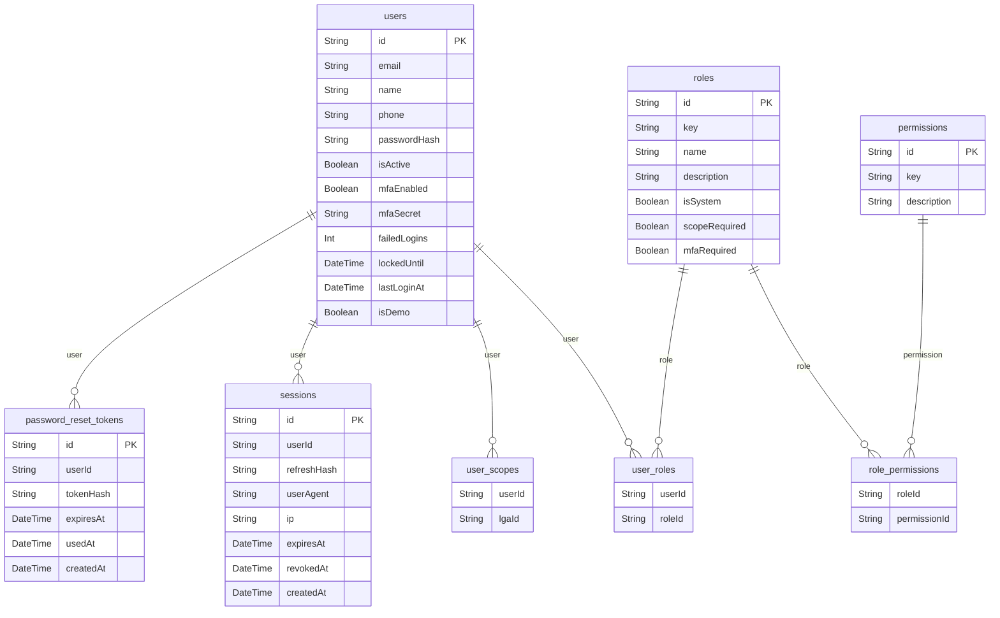
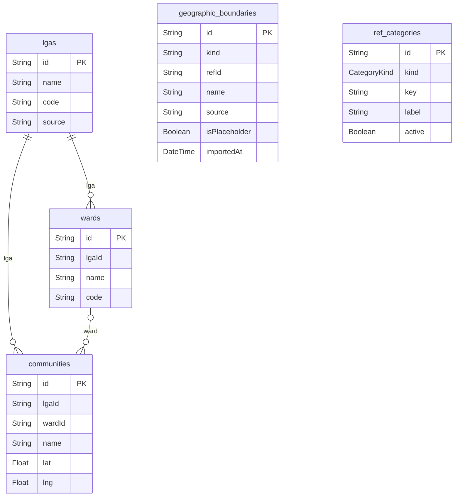
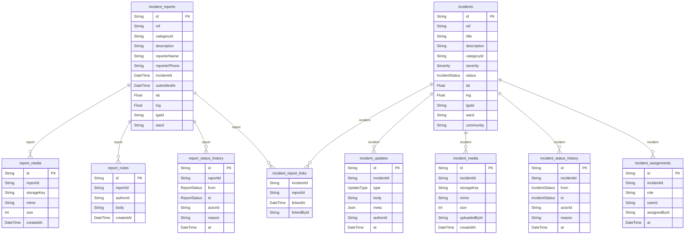
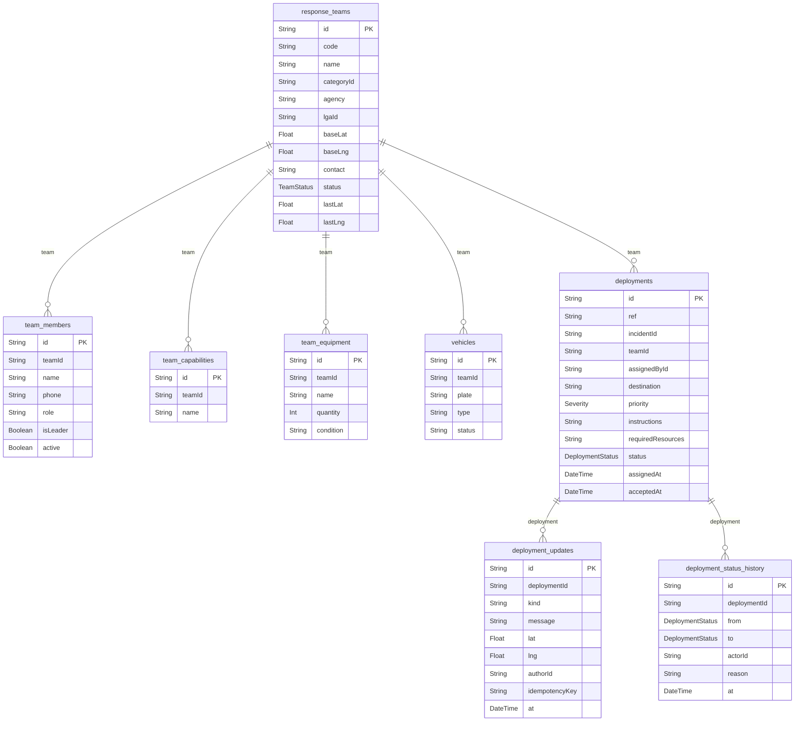
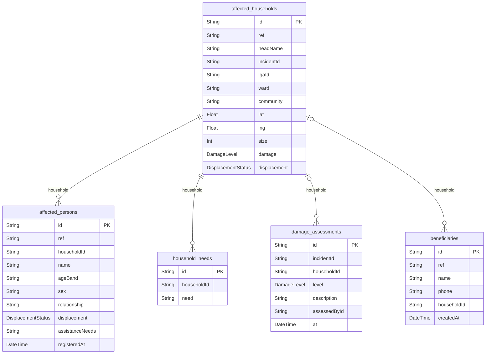
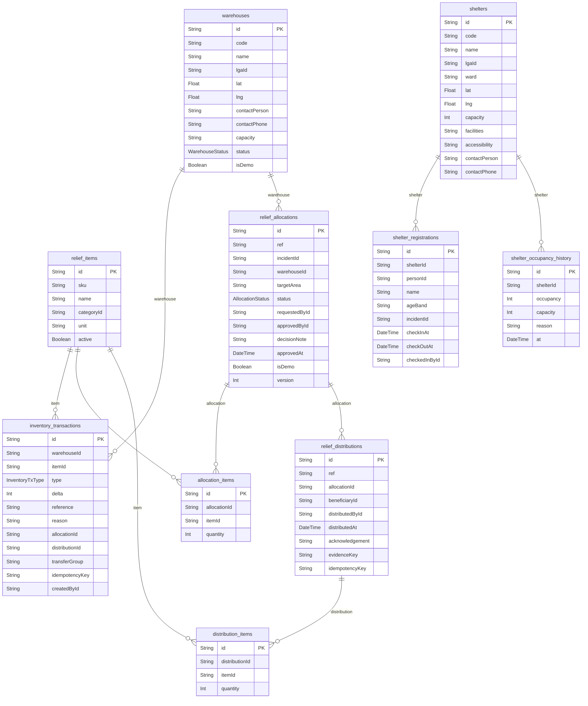
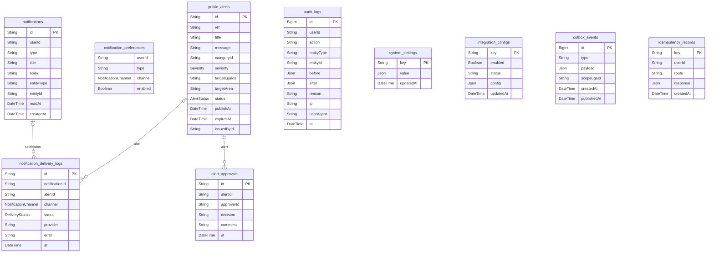

# Entity relationship diagrams

> Generated from `apps/api/prisma/schema.prisma` by `npm -w apps/api run db:erd`. Do not edit by hand.
> PostGIS `geom` columns (incidents, incident_reports, shelters, warehouses, response_teams, geographic_boundaries) are added by migration `0002` and are not modelled in Prisma.

## Identity & access

## Geography

## Reports & incidents

## Response operations

## Affected population

## Relief & shelters

## Notifications, alerts & governance

## Foreign-key inventory (63)

- user_roles → users
- user_roles → roles
- role_permissions → roles
- role_permissions → permissions
- user_scopes → users
- user_scopes → lgas
- sessions → users
- password_reset_tokens → users
- wards → lgas
- communities → lgas
- communities → wards
- incident_reports → ref_categories
- incident_reports → lgas
- report_media → incident_reports
- report_notes → incident_reports
- report_status_history → incident_reports
- incidents → ref_categories
- incidents → lgas
- incident_report_links → incidents
- incident_report_links → incident_reports
- incident_updates → incidents
- incident_media → incidents
- incident_status_history → incidents
- incident_assignments → incidents
- response_teams → ref_categories
- response_teams → lgas
- team_members → response_teams
- team_capabilities → response_teams
- team_equipment → response_teams
- vehicles → response_teams
- deployments → incidents
- deployments → response_teams
- deployment_updates → deployments
- deployment_status_history → deployments
- affected_households → incidents
- affected_households → lgas
- affected_persons → affected_households
- household_needs → affected_households
- damage_assessments → incidents
- damage_assessments → affected_households
- relief_items → ref_categories
- warehouses → lgas
- inventory_transactions → warehouses
- inventory_transactions → relief_items
- relief_allocations → incidents
- relief_allocations → warehouses
- allocation_items → relief_allocations
- allocation_items → relief_items
- beneficiaries → affected_households
- relief_distributions → relief_allocations
- relief_distributions → beneficiaries
- distribution_items → relief_distributions
- distribution_items → relief_items
- shelters → lgas
- shelter_registrations → shelters
- shelter_registrations → affected_persons
- shelter_occupancy_history → shelters
- notifications → users
- notification_preferences → users
- public_alerts → ref_categories
- alert_approvals → public_alerts
- notification_delivery_logs → notifications
- notification_delivery_logs → public_alerts
